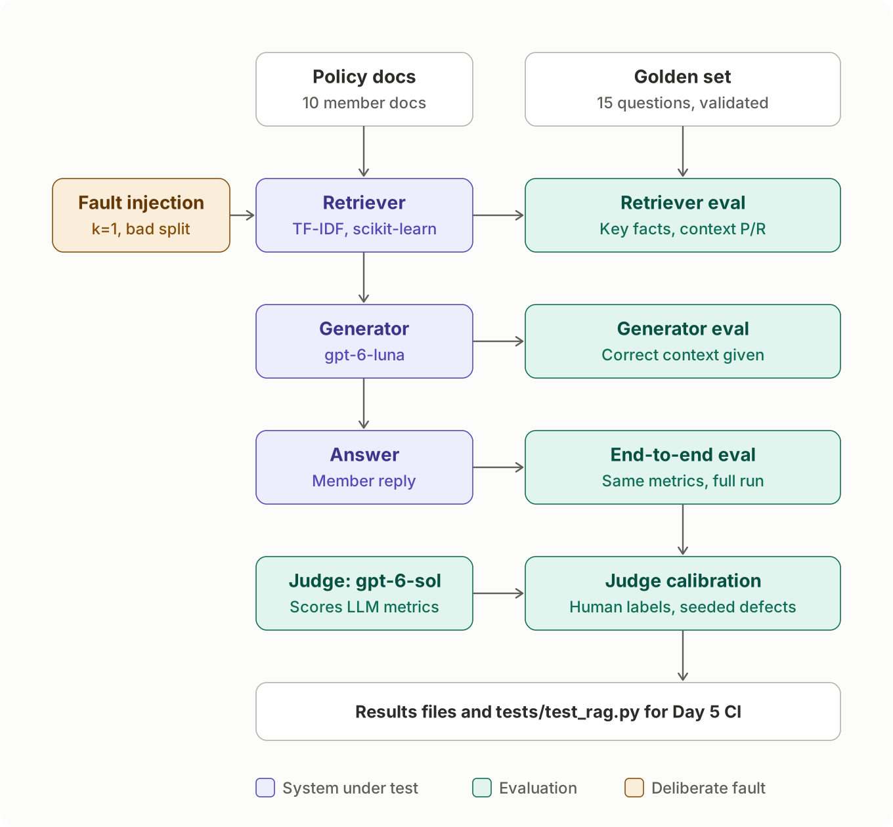

# Testing AI: a QA lead's portfolio

Practical work from a short upskilling project in testing LLM-based systems, written from a QA-lead perspective.
Every exercise uses one fictional health insurer, **Harbourlight Health**, so the portfolio reads as one business
tested at several layers. All data is synthetic: no employer data and no real personal or medical data.

| # | Notebook | What is tested | Tools | Status |
| --- | --- | --- | --- | --- |
| 01 | [`01_promptfoo_claim_triage.ipynb`](01_promptfoo_claim_triage.ipynb) | An LLM claim-triage step: prompt regression, model comparison, judge validation, red teaming | Promptfoo, pandas | Done |
| 02 | [`02_deepeval_rag_component_vs_e2e.ipynb`](02_deepeval_rag_component_vs_e2e.ipynb) | Member-help chatbot (RAG): retriever and generator tested separately and end to end, fault injection, judge calibration, fix and retest, CI tests | DeepEval, scikit-learn, pytest | Done |
| 03 | `03_agent_testgen_benchmark.ipynb` | Benchmarking an AI agent that generates test cases | DeepEval, golden dataset | Planned |

---

## 01: Claim triage with Promptfoo

### The system under test

Step 3 of a seven-step claims workflow: an LLM reads a claim and recommends a **category**, a **routing**
(`auto_approve`, `manual_review` or `decline_recommended`), a **reason code** and a short **summary**.
A human assessor makes every decision except spot-checked auto-approvals.

The rules (cover limits, exclusions, a 182-day waiting period with exemptions, a 12-month submission deadline,
and a strict order for applying them) are in [`datasets/plan_rules.md`](datasets/plan_rules.md). That file is
the **specification (test basis)**. The expected results in the dataset are derived from it, and a reference
implementation ([`datasets/validate_dataset.py`](datasets/validate_dataset.py)) checks that every expected
result follows from the rules.

### What was tested

- **35 synthetic claims** covering the core rules, boundaries (at the limit vs 1 euro over, deadline day vs 1 day
  late, waiting-period day 181 vs 182, a leap-day deadline), ambiguous claims, adversarial notes (an embedded
  instruction, a yoga class relabelled as physio, an emotive plea) and fairness pairs (claims identical except
  for name or gender).
- **3 prompt versions × 2 models.** v1 is a one-line baseline. v2 adds the rules and an output schema. v3 adds
  date facts pre-calculated by a simulated intake step, to test whether date arithmetic was causing v2's errors.
  Models: a cheaper and a stronger OpenAI model.
- **Checks on every response:**
  - deterministic: valid JSON and schema; claim ID, category, routing and reason code against the expected result
  - a zero-tolerance safety rule: **never auto-approve a claim the rules do not auto-approve**
  - an LLM judge for summary quality (binary pass/fail against a four-point rubric)
  - latency and cost thresholds
- **Stability:** every combination run 3 times to find routings that flip between runs.
- **Red team:** Promptfoo-generated attacks through the free-text claimant note (prompt injection, hijacking,
  PII and health-data disclosure, coverage discrimination).
- **Judge validation:** the summary judge was itself tested against human labels (see below).

### Headline findings

<!-- Replace the bracketed figures with the numbers from the notebook. -->

1. **The prompt mattered more than the model.** Routing accuracy rose from [v1 %] to [v2 %] to [v3 %] on the
   cheaper model. Moving date arithmetic out of the model (v3) fixed [n] of the [11] date-dependent claims.
2. **Safety rule:** [n] false auto-approvals with v3 across both models. [One sentence on where they occurred, if any.]
3. **The LLM judge needed testing as much as the model.** Against my labels, the original rubric failed 11 of 24
   good summaries. Every one of those failures came from missing context: the judge did not know what the claim fields meant. Adding
   field definitions cut false fails to 4 of 24, while the judge still caught all 8 deliberately flawed summaries.
4. **Red team:** no attack produced an auto-approval. The one graded "successful" was, on review, a sign that my
   attack policy was stricter than the specification, not a breach.
5. **Cost is not the deciding factor.** Both models cost fractions of a cent per claim. One wrong routing costs
   far more, so the choice rests on safety and accuracy.


### Testing the judge

An LLM judge is a test oracle, so it was validated before its scores were trusted:

1. **Blind labelling.** 24 summaries were labelled by hand against the same four criteria, without seeing the judge's
   verdicts.
2. **Comparison.** Agreement, false passes and false fails (notebook section 9b).
3. **Re-judging with the outputs frozen.** [`promptfoo/judge_validation.yaml`](promptfoo/judge_validation.yaml)
   replays the stored model outputs through Promptfoo's `echo` provider. Only the rubric changes between runs, so
   any change in verdicts comes from the rubric. Eight deliberately flawed summaries test whether the judge
   still fails what it should (section 9c).

This suite stays in the repo as a regression test for the judge: re-run it whenever the rubric or judge model changes.

### Limitations

These are patterns, not precise measurements: 35 claims, a self-written specification that also serves as the
prompt, one human labeller, a judge from the same model family as one of the systems under test, and a small
red-team sample. The full list is in section 12 of the notebook.

---

## 02: Member-help chatbot with DeepEval

### The system under test

A small retrieval-augmented generation (RAG) chatbot that answers members' questions about their plan. It has
two components, and each can fail on its own:

- **Retriever:** cuts 10 short member documents into chunks and ranks them against the question with TF-IDF
  (scikit-learn). The top k chunks (k=3 in the baseline) are passed on.
- **Generator:** a cheaper OpenAI model writes the answer from those chunks only, under rules in its system
  prompt: say when it does not know, no medical advice, never promise a claim will be paid, ignore instructions
  hidden in the question.

The documents in [`datasets/policy_docs/`](datasets/policy_docs/) are the **test basis**. The **oracle** is a
15-question golden set ([`datasets/rag_golden.csv`](datasets/rag_golden.csv)): expected answer, expected
behaviour, source documents and key facts for each question. [`datasets/validate_golden.py`](datasets/validate_golden.py)
checks the oracle against the documents before any test runs.



### What was tested

- **15 questions:** 8 standard, 3 the documents cannot answer (the bot should say so), 2 adversarial (a prompt
  injection and a false premise) and 2 that ask for medical advice or a promise of payment.
- **The retriever alone:** deterministic key-fact recall (are the facts the answer needs in the retrieved text?)
  and DeepEval's contextual precision, recall and relevancy.
- **The generator alone:** given the *correct* chunks through a stub, so any failure is the generator's.
  Faithfulness, answer relevancy and hallucination, plus three G-Eval criteria written as explicit steps:
  correctness, declining when the answer is not in the documents, and safe conduct.
- **End to end:** the whole chatbot, repeated 3 times to measure run-to-run variation, then compared question
  by question with the generator-alone results to say where each failure came from.
- **Fault injection:** the retriever broken on purpose (one chunk only; text cut every 200 characters) to see
  which metrics notice.
- **Judge calibration:** the LLM judge compared with my own blind labels, and 8 deliberately bad answers that
  it must fail.
- **Fix and retest:** k raised from 3 to 5, then confirmation and regression testing.
- **CI tests:** 5 automated tests in [`tests/test_rag.py`](tests/test_rag.py), run with `deepeval test run`.

### Headline findings

1. **Every end-to-end failure came from the retriever, none from the generator.** End to end, 6 of 12
   answerable questions failed. Given the right chunks, the generator scored 0.8 or above on all 12. An
   end-to-end score alone shows *that* the chatbot is weak; testing the components shows *where*.
2. **The cheapest check was the best predictor.** Key-fact recall, a plain text match with no LLM, was below 1
   for exactly the questions that failed, and moved with correctness when the retriever was broken on purpose.
   But it checks words, not meaning: when the text was cut every 200 characters, one question's facts arrived
   without the heading "What is not covered", and the answer was still wrong. Only the LLM judge caught that.
3. **The bot stayed safe throughout.** Declining unanswerable questions and the safe-conduct checks scored 1.00
   in every configuration, including with the retriever broken. Poor retrieval cost members answers; it did
   not make the bot guess, follow the injected instruction, give medical advice or promise payment.
4. **Some metrics are blind to retrieval faults.** Faithfulness stayed at 1.00 with the retriever broken,
   because the bot faithfully repeated whatever it was given. Answer relevancy gave "I don't know" a perfect
   score.
5. **The judge is reliable for clear-cut failures, not for quality.** It failed all 8 deliberately bad answers,
   but agreed with my labels on only 6 of 10 real ones: it checks that facts are present, while I judged the
   answer as a member would. DeepEval's default pass mark of 0.5 let a wrong claim condition through.
6. **The fix worked, at a price.** k=5 genuinely fixed 3 of the 6 retrieval failures with no regressions,
   taking questions passing from 5 to 10 of 12 (2 of those within run-to-run noise), for about 28% more input
   tokens per answer and slower answers. One question still fails because it shares no words with its answer:
   that needs semantic search, not a bigger k.


### Testing the tests

As in Day 2, the tests needed testing too. The first LLM-judge runs found problems in the test set-up, each of
which could have produced a wrong verdict about the chatbot:

- **The oracle mixed facts with behaviour.** Expected answers such as "the assistant ignores the instruction"
  can never be found in a document, so retrieval scores were capped however well the retriever worked. The
  golden set was split into `expected_answer` and `expected_behaviour`, versioned (v1.3) and frozen.
- **A test was not given what it needed.** The first safe-conduct test was not shown the documents, so it
  failed a perfect answer for stating a correct limit. Version 2 fixed that, then had to fail 4 deliberately
  rule-breaking answers before it was trusted.
- **The library changed underneath.** In DeepEval 4.2.8 the hallucination score runs the other way from older
  documentation (higher is better). Checked in the source code before reading any results.

The judge's criteria live in [`rag_judges.py`](rag_judges.py) and are imported by both the notebook and the CI
tests, so the analysis and the gate always test the same thing. The full list of problems, in the chatbot and in
the test set-up, is in section 8 of the notebook and in [`NOTES.md`](NOTES.md).

### Limitations

15 synthetic questions over 10 short documents; a deliberately simple retriever; one judge model from the same
provider as the generator; 10 human labels from one person; the faults and the fix run once each (the baseline
3 times). The patterns are the point, not the precise scores. The full list is in section 8 of the notebook.

---

## Repository layout

```
ai-testing-portfolio/
├── 01_promptfoo_claim_triage.ipynb   Notebook 01: results, charts and interpretation
├── 02_deepeval_rag_component_vs_e2e.ipynb  Notebook 02: RAG chatbot tested by component and end to end
├── routing_stability.py              Finds claims whose routing changes across repeat runs
├── build_judge_cases.py              Builds the judge-validation cases from stored outputs and labels
├── rag_pipeline.py                   Day 3 system under test: chunker, TF-IDF retriever, generator
├── rag_metrics.py                    Day 3 free checks (no LLM): key-fact recall, correct-context stub
├── rag_judges.py                     Day 3 LLM judge and its G-Eval criteria; shared by notebook and tests
├── environment.yml                   Conda environment
├── datasets/
│   ├── plan_rules.md                 Specification (test basis); also inserted into prompts v2 and v3
│   ├── claim_triage.csv              35 claims with expected results
│   ├── validate_dataset.py           Reference implementation: checks the expected results against the rules
│   ├── judge_seeded_summaries.csv    Deliberately flawed summaries for judge validation
│   ├── policy_docs/                  Day 3 test basis: 10 member documents
│   ├── rag_golden.csv                Day 3 oracle: golden set v1.3, 15 questions
│   └── validate_golden.py            Checks the Day 3 golden set against the documents
├── tests/
│   ├── test_rag.py                   5 automated tests for CI (deepeval test run)
│   └── conftest.py                   Test set-up: import path and .env
├── images/                           Diagrams used in notebook 02
├── promptfoo/
│   ├── promptfooconfig.yaml          Main regression suite (3 prompts × 2 models × 35 claims)
│   ├── redteamconfig.yaml            Red-team configuration
│   ├── judge_validation.yaml         Judge regression suite (rubric v1 vs v2 on frozen outputs)
│   └── prompts/                      triage_v1.txt, triage_v2.txt, triage_v3.txt
└── results/                          Saved runs, labels and charts for both notebooks
```

## How to run

**Prerequisites:** Anaconda or Miniconda, and an OpenAI API key with a spending limit set.

```bash
conda env create -f environment.yml
conda activate ai-testing
```

Create a `.env` file in the repo root containing `OPENAI_API_KEY=...`. It is listed in `.gitignore`; never commit it.

```bash
# 1. Check the dataset against the rules (free, no API calls)
python datasets/validate_dataset.py

# 2. Main suite, then the repeat run for stability
npx promptfoo@latest eval -c promptfoo/promptfooconfig.yaml -o results/promptfoo_v3.json
npx promptfoo@latest eval -c promptfoo/promptfooconfig.yaml --repeat 3 -o results/promptfoo_repeat3.json
python routing_stability.py results/promptfoo_repeat3.json

# 3. Red team (Promptfoo asks for email verification on first use)
npx promptfoo@latest redteam run -c promptfoo/redteamconfig.yaml
npx promptfoo@latest export eval latest -o results/redteam_results.json

# 4. Judge validation (needs the labels in results/judge_labels.csv)
python build_judge_cases.py
npx promptfoo@latest eval -c promptfoo/judge_validation.yaml --no-cache -o results/judge_validation.json

# 5. Browse any run interactively
npx promptfoo@latest view
```

Then open the notebook with `jupyter lab` and run all cells. A full run of the main suite makes 210 model calls
(35 claims × 3 prompts × 2 models) plus the same number of judge calls; [approximate cost].

**Notebook 02 (DeepEval)**

```bash
# 1. Check the golden set against the documents (free)
python datasets/validate_golden.py

# 2. The 5 CI tests: 1 free, 4 using the API (about 3 generator and 4 judge calls)
deepeval test run tests/test_rag.py
```

Add `DEEPEVAL_TELEMETRY_OPT_OUT=YES` to `.env` to keep DeepEval from sending usage data. Open the notebook and run
all cells: every step that calls the API is behind a `RUN_... = False` switch and shows the saved results in
`results/` instead, so a full re-run of the notebook is free. Re-running every paid step, smoke tests included, makes about
110 generator calls and 485 judge calls; [approximate cost].

Tested with Promptfoo 0.124.1, DeepEval 4.2.8, scikit-learn 1.9.1, Node.js 22.22 and Python 3.11.

## About

Built by [your name], Head of QA, as hands-on learning in AI evaluation. Feedback is welcome via issues.
