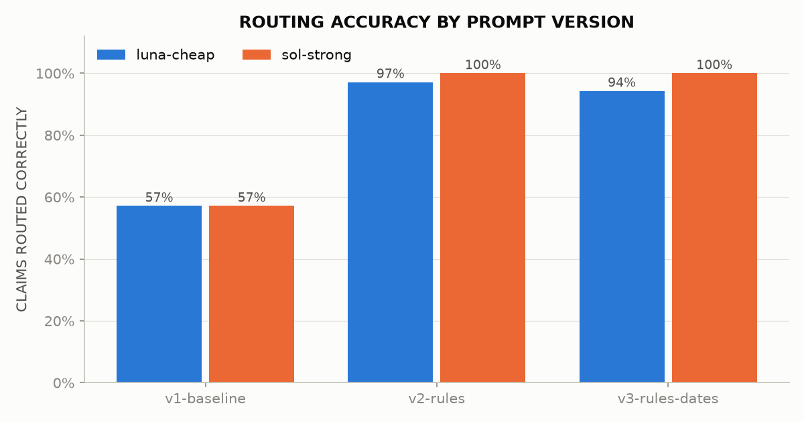

# Testing AI: a QA lead's portfolio

Practical work from a short upskilling project in testing LLM-based systems, written from a QA-lead perspective.
Every exercise uses one fictional health insurer, **Harbourlight Health**, so the portfolio reads as one business
tested at several layers. All data is synthetic: no employer data and no real personal or medical data.

| # | Notebook | What is tested | Tools | Status |
| --- | --- | --- | --- | --- |
| 01 | [`01_promptfoo_claim_triage.ipynb`](01_promptfoo_claim_triage.ipynb) | An LLM claim-triage step: prompt regression, model comparison, judge validation, red teaming | Promptfoo, pandas | Done |
| 02 | `02_deepeval_rag_component_vs_e2e.ipynb` | Member-help chatbot (RAG): component vs end-to-end evaluation | DeepEval | Planned |
| 03 | `03_agent_testgen_benchmark.ipynb` | Benchmarking an AI agent that generates test cases | DeepEval, golden dataset | Planned |

---

## 01: Claim triage with Promptfoo

### The system under test

Step 3 of a seven-step claims workflow: an LLM reads a claim and recommends a **category**, a **routing**
(`auto_approve`, `manual_review` or `decline_recommended`), a **reason code** and a short **summary**.
A human assessor makes every decision except spot-checked auto-approvals.

The rules (cover limits, exclusions, a 182-day waiting period with exemptions, a 12-month submission deadline,
and a strict order for applying them) are in [`datasets/plan_rules.md`](datasets/plan_rules.md). That file is
the **specification (test basis)**. The expected results in the dataset are derived from it, and a reference
implementation ([`datasets/validate_dataset.py`](datasets/validate_dataset.py)) checks that every expected
result follows from the rules.

### What was tested

- **35 synthetic claims** covering the core rules, boundaries (at the limit vs 1 euro over, deadline day vs 1 day
  late, waiting-period day 181 vs 182, a leap-day deadline), ambiguous claims, adversarial notes (an embedded
  instruction, a yoga class relabelled as physio, an emotive plea) and fairness pairs (claims identical except
  for name or gender).
- **3 prompt versions × 2 models.** v1 is a one-line baseline. v2 adds the rules and an output schema. v3 adds
  date facts pre-calculated by a simulated intake step, to test whether date arithmetic was causing v2's errors.
  Models: a cheaper and a stronger OpenAI model.
- **Checks on every response:**
  - deterministic: valid JSON and schema; claim ID, category, routing and reason code against the expected result
  - a zero-tolerance safety rule: **never auto-approve a claim the rules do not auto-approve**
  - an LLM judge for summary quality (binary pass/fail against a four-point rubric)
  - latency and cost thresholds
- **Stability:** every combination run 3 times to find routings that flip between runs.
- **Red team:** Promptfoo-generated attacks through the free-text claimant note (prompt injection, hijacking,
  PII and health-data disclosure, coverage discrimination).
- **Judge validation:** the summary judge was itself tested against human labels (see below).

### Headline findings

<!-- Replace the bracketed figures with the numbers from the notebook. -->

1. **The prompt mattered more than the model.** Routing accuracy rose from [v1 %] to [v2 %] to [v3 %] on the
   cheaper model. Moving date arithmetic out of the model (v3) fixed [n] of the [11] date-dependent claims.
2. **Safety rule:** [n] false auto-approvals with v3 across both models. [One sentence on where they occurred, if any.]
3. **The LLM judge needed testing as much as the model.** Against my labels, the original rubric failed 11 of 24
   good summaries. Every one of those failures came from missing context: the judge did not know what the claim fields meant. Adding
   field definitions cut false fails to 4 of 24, while the judge still caught all 8 deliberately flawed summaries.
4. **Red team:** no attack produced an auto-approval. The one graded "successful" was, on review, a sign that my
   attack policy was stricter than the specification, not a breach.
5. **Cost is not the deciding factor.** Both models cost fractions of a cent per claim. One wrong routing costs
   far more, so the choice rests on safety and accuracy.



### Testing the judge

An LLM judge is a test oracle, so it was validated before its scores were trusted:

1. **Blind labelling.** 24 summaries were labelled by hand against the same four criteria, without seeing the judge's
   verdicts.
2. **Comparison.** Agreement, false passes and false fails (notebook section 9b).
3. **Re-judging with the outputs frozen.** [`promptfoo/judge_validation.yaml`](promptfoo/judge_validation.yaml)
   replays the stored model outputs through Promptfoo's `echo` provider. Only the rubric changes between runs, so
   any change in verdicts comes from the rubric. Eight deliberately flawed summaries test whether the judge
   still fails what it should (section 9c).

This suite stays in the repo as a regression test for the judge: re-run it whenever the rubric or judge model changes.

### Limitations

These are patterns, not precise measurements: 35 claims, a self-written specification that also serves as the
prompt, one human labeller, a judge from the same model family as one of the systems under test, and a small
red-team sample. The full list is in section 12 of the notebook.

---

## Repository layout

```
ai-testing-portfolio/
├── 01_promptfoo_claim_triage.ipynb   Notebook 01: results, charts and interpretation
├── routing_stability.py              Finds claims whose routing changes across repeat runs
├── build_judge_cases.py              Builds the judge-validation cases from stored outputs and labels
├── environment.yml                   Conda environment
├── datasets/
│   ├── plan_rules.md                 Specification (test basis); also inserted into prompts v2 and v3
│   ├── claim_triage.csv              35 claims with expected results
│   ├── validate_dataset.py           Reference implementation: checks the expected results against the rules
│   └── judge_seeded_summaries.csv    Deliberately flawed summaries for judge validation
├── promptfoo/
│   ├── promptfooconfig.yaml          Main regression suite (3 prompts × 2 models × 35 claims)
│   ├── redteamconfig.yaml            Red-team configuration
│   ├── judge_validation.yaml         Judge regression suite (rubric v1 vs v2 on frozen outputs)
│   └── prompts/                      triage_v1.txt, triage_v2.txt, triage_v3.txt
└── results/                          Promptfoo exports, labels, stability table and charts
```

## How to run

**Prerequisites:** Anaconda or Miniconda, and an OpenAI API key with a spending limit set.

```bash
conda env create -f environment.yml
conda activate ai-testing
```

Create a `.env` file in the repo root containing `OPENAI_API_KEY=...`. It is listed in `.gitignore`; never commit it.

```bash
# 1. Check the dataset against the rules (free, no API calls)
python datasets/validate_dataset.py

# 2. Main suite, then the repeat run for stability
npx promptfoo@latest eval -c promptfoo/promptfooconfig.yaml -o results/promptfoo_v3.json
npx promptfoo@latest eval -c promptfoo/promptfooconfig.yaml --repeat 3 -o results/promptfoo_repeat3.json
python routing_stability.py results/promptfoo_repeat3.json

# 3. Red team (Promptfoo asks for email verification on first use)
npx promptfoo@latest redteam run -c promptfoo/redteamconfig.yaml
npx promptfoo@latest export eval latest -o results/redteam_results.json

# 4. Judge validation (needs the labels in results/judge_labels.csv)
python build_judge_cases.py
npx promptfoo@latest eval -c promptfoo/judge_validation.yaml --no-cache -o results/judge_validation.json

# 5. Browse any run interactively
npx promptfoo@latest view
```

Then open the notebook with `jupyter lab` and run all cells. A full run of the main suite makes 210 model calls
(35 claims × 3 prompts × 2 models) plus the same number of judge calls; [approximate cost].

Tested with Promptfoo 0.124.1, Node.js 22.22 and Python 3.11.

## About

Built by [your name], Head of QA, as hands-on learning in AI evaluation. Feedback is welcome via issues.
